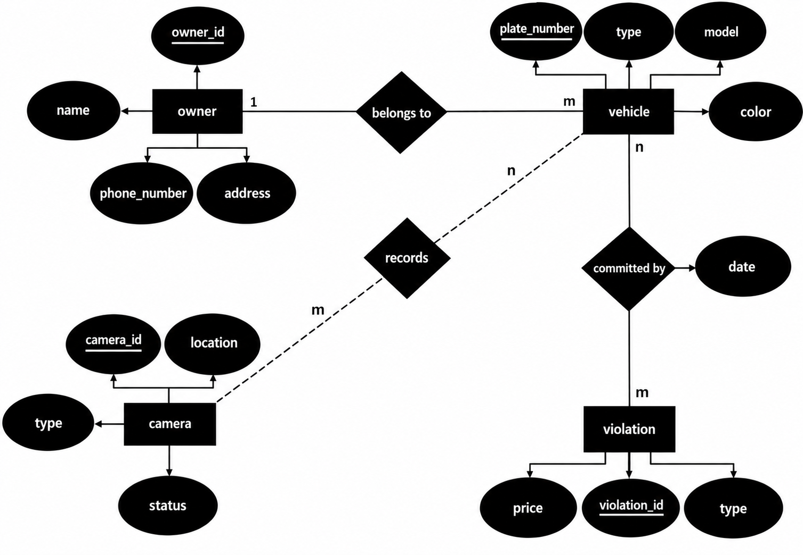
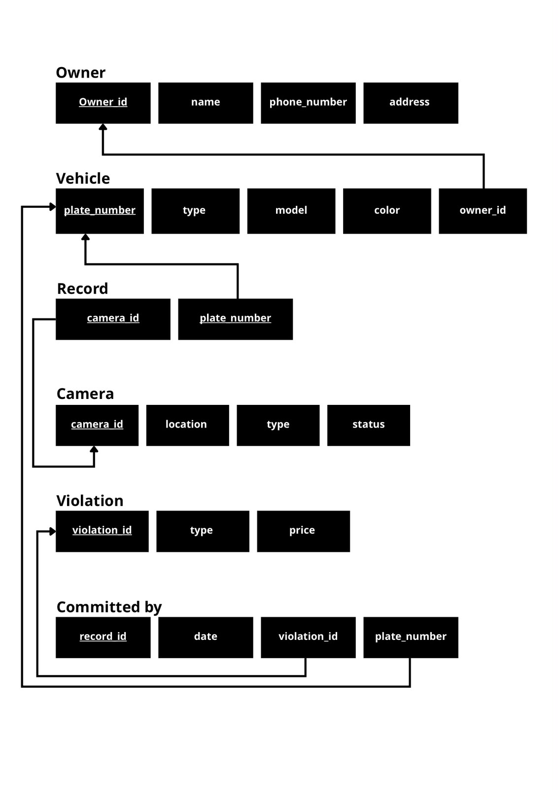

# Saher System Database

## Project Overview

Saher System is a database project that simulates a traffic violation monitoring system using MySQL. The project focuses on creating an Entity-Relationship Diagram (ERD) and a Relational Schema, followed by implementing the database using SQL to manage vehicle owners, vehicles, traffic cameras, and violations.

## Project Scenario

The system manages vehicle owners and their vehicles, records vehicles detected by traffic cameras, and tracks traffic violations.

Each owner can own multiple vehicles, while each vehicle is associated with an owner. Cameras can record multiple vehicles, and a vehicle can be recorded by multiple cameras. Vehicles can also have multiple recorded traffic violations, each associated with a violation type and date.

The project models these relationships and provides SQL queries to retrieve and summarize violation records.

## Database Structure

The database consists of six tables:

| Table | Description |
|---|---|
| owners | Stores vehicle owners' information, including names, phone numbers, and addresses. |
| vehicles | Stores vehicle details and links each vehicle to its owner. |
| cameras | Stores traffic camera information, including locations, types, and statuses. |
| violations | Stores traffic violation types and their prices. |
| records | Represents the relationship between vehicles and cameras. |
| committedby | Records vehicle violations, including the violation type and date. |

## Database Design

### Entity-Relationship Diagram (ERD)

### Relational Schema

## SQL Queries

The project includes queries to:

1. Retrieve violation records after a specific date.
2. Display violations with a price greater than 300.
3. Count the number of violations for each vehicle.
4. Calculate the average violation price for each owner, including owners with no violations.
5. Display vehicle plate numbers, owner names, vehicle models, violation types, and dates.
6. Find vehicles with more than one recorded violation.
7. Create a view that summarizes violation records and their associated owners.

## How to Run

1. Open MySQL Workbench and connect to a MySQL server.
2. Open the `Saher_System.sql` file.
3. Execute the SQL script to create the database and tables and insert the sample data.
4. Run the SQL queries to explore the results.
